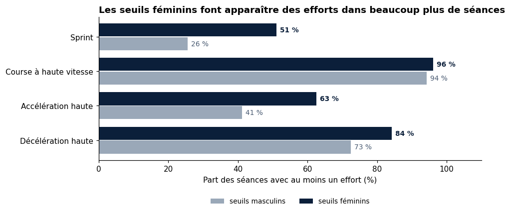
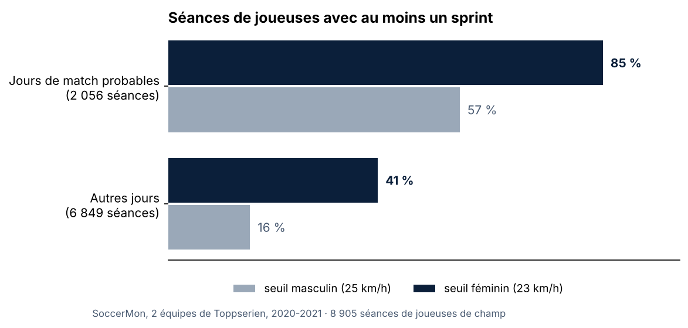
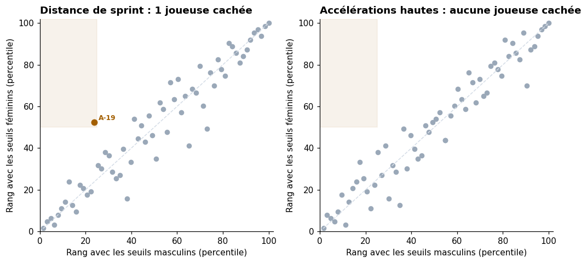

# vestiaire-metrics

**Seuils de vitesse féminins appliqués à 10 000 séances GPS de football féminin, et indicateurs de suivi de charge pour les staffs.**

> En match, avec le seuil de sprint masculin (25 km/h), **43 %** des séances de joueuses ne contiennent aucun sprint. Avec le seuil féminin (23 km/h), elles ne sont plus que **15 %**.

Ce dépôt est le moteur de calcul de **Vestiaire**, un projet d'application de suivi pour les staffs de football féminin : charge d'entraînement, forme des joueuses, profils physiques. Il a été testé sur [SoccerMon](https://osf.io/uryz9/), un jeu de données ouvert sur deux équipes féminines norvégiennes de première division.

*In English: this repository applies women-specific speed and acceleration thresholds to 10,000 GPS sessions from two elite women's teams (SoccerMon open dataset). With the men's sprint threshold, 43% of players' match-day sessions show no sprint at all; with the women's threshold, 15%. It also contains the load and wellness metrics (sRPE, acute:chronic ratio, monotony, personal wellness baseline) behind the Vestiaire app prototype.*

---

## Pourquoi des seuils féminins

La plupart des données physiques du football utilisent des seuils calibrés sur le jeu masculin : un sprint commence à 25 km/h, une accélération haute à 3 m/s². Appliqués au football féminin, ces seuils ramènent beaucoup de joueuses à zéro et rendent leurs profils difficiles à distinguer.

En octobre 2026, SkillCorner a présenté des seuils calibrés sur les matchs féminins. Ce projet les applique à des données GPS d'entraînement et de match, indépendantes de celles de SkillCorner.

| Zone | Seuil masculin | Seuil féminin |
| --- | --- | --- |
| Course à haute vitesse | 20-25 km/h | 19-23 km/h |
| Sprint | au-delà de 25 km/h | au-delà de 23 km/h |
| Accélération haute | au-delà de 3 m/s² | au-delà de 2,7 m/s² |

## Résultats sur SoccerMon

**Données** : 10 075 fichiers GPS (STATSports, 10 Hz), deux équipes de Toppserien, juin 2020 à novembre 2021. Après contrôle qualité, 8 905 séances de joueuses de champ (68 joueuses) ; les gardiennes probables sont écartées.

### 1. Les seuils féminins font apparaître deux fois plus de séances avec un sprint



| Part des séances avec au moins un… | Seuil masculin | Seuil féminin |
| --- | --- | --- |
| Sprint | 26 % | 51 % |
| Accélération haute | 41 % | 63 % |
| Décélération haute | 73 % | 84 % |
| Course à haute vitesse | 94 % | 96 % |

### 2. L'écart reste net en match

SoccerMon ne distingue pas les matchs des entraînements. Les jours où au moins 8 joueuses d'une équipe dépassent 7 km en médiane ressemblent à des matchs : 137 jours, 2 056 séances, 8,6 km de médiane.



Sur ces jours de match, la distance de sprint médiane par joueuse passe de **16 m** avec le seuil masculin à **69 m** avec le seuil féminin.

### 3. Le classement des joueuses change peu, sauf exception

Chaque joueuse ayant au moins 10 séances (63 joueuses) est classée deux fois, une fois avec chaque jeu de seuils. Les deux classements sont très proches : corrélation de rang de 0,96 pour le sprint et 0,97 pour les accélérations hautes.

Une joueuse fait exception : **A-19** passe du 24e au 52e percentile en distance de sprint. Avec le seuil masculin, elle paraît dans le quart le moins rapide ; avec le seuil féminin, elle est au-dessus de la médiane.



**Ce qu'on en retient** : sur une saison, les seuils féminins changent surtout *ce qu'on mesure* chez chaque joueuse (deux fois plus de séances avec sprint, quatre fois plus de distance de sprint en match), beaucoup moins *l'ordre* des joueuses. C'est cohérent avec SkillCorner, dont l'exemple le plus marquant portait sur des actions rares mesurées en match. Pour un staff, l'enjeu est concret : avec un seuil masculin, une séance où une joueuse a sprinté à 24 km/h apparaît comme une séance sans sprint.

### Limites

- Les jours de match sont estimés : SoccerMon ne distingue pas match et entraînement.
- Les gardiennes sont repérées par leur vitesse maximale médiane (sous 20 km/h), sans confirmation.
- Les seuils féminins de SkillCorner ont été calibrés sur des données de match par vidéo. Ici, ils sont appliqués à des données GPS, dont les mesures de vitesse ne sont pas strictement identiques.
- Deux équipes d'un même championnat : les résultats ne se généralisent pas tels quels.

## Méthode GPS

- Une ligne gardée par instant : dans les fichiers SoccerMon, chaque instant GPS (10 Hz) est répété environ 10 fois, car l'accéléromètre enregistre à 100 Hz.
- Distance intégrée avec le vrai pas de temps ; trous de signal de plus d'une seconde non comblés ; instants sans satellite et vitesses au-delà de 36 km/h écartés.
- Vitesse lissée par une médiane sur 0,5 s pour la vitesse maximale, les sprints et les accélérations.
- Sprint compté s'il dure au moins 1 s ; accélération ou décélération haute, au moins 0,5 s.
- Séance retenue : au moins 10 minutes de signal et 300 m parcourus.

Code : [`vestiaire_metrics/gps.py`](vestiaire_metrics/gps.py) et [`analyser_soccermon.py`](analyser_soccermon.py).

## Les indicateurs de Vestiaire

Le module calcule aussi ce qu'affiche le prototype de l'application :

| Indicateur | Fonction |
| --- | --- |
| Charge d'une séance (note × durée, sRPE) | `srpe`, `charge_quotidienne` |
| Ratio aigu / chronique (découplé, couplé, EWMA) | `ratio_aigu_chronique` |
| Monotonie et contrainte | `monotonie`, `contrainte` |
| Forme du jour sur 25, comparée à la moyenne personnelle | `score_forme`, `reference_personnelle` |
| Statut du jour et explication en français | `statut_du_jour` |
| Zones de vitesse et d'accélération féminines | `zone_vitesse`, `resume_gps` |

Le carnet [`notebooks/01_indicateurs_vestiaire.ipynb`](notebooks/01_indicateurs_vestiaire.ipynb) montre ces calculs sur un effectif fictif.

## Reproduire

```bash
git clone https://github.com/julie-landrevie/vestiaire-metrics.git
cd vestiaire-metrics
python3 -m venv .venv && source .venv/bin/activate
pip install -r requirements.txt && pip install -e .
pytest

# après avoir téléchargé les fichiers GPS de SoccerMon (osf.io/uryz9)
python analyser_soccermon.py --gps ~/chemin/vers/SoccerMon_GPS
open resultats_vestiaire/rapport_vestiaire.html
```

L'analyse complète lit environ 10 000 fichiers ; elle peut être interrompue et reprise. Mode d'emploi détaillé : [`LANCER_SUR_MON_MAC.md`](LANCER_SUR_MON_MAC.md).

## Ce que ces indicateurs ne sont pas

Des repères pour aider un staff à décider, pas un diagnostic ni une prédiction de blessure.

## Références

- Midoglu C. et al. (2024). A large-scale multivariate soccer athlete health, performance, and position monitoring dataset. *Scientific Data*. Données sous licence CC-BY 4.0.
- SkillCorner (2026). *Women's Football: Dedicated Data, Smarter Decisions*, webinaire du 12 octobre 2026.
- Foster C. et al. (2001). A new approach to monitoring exercise training. *Journal of Strength and Conditioning Research*.
- Williams S. et al. (2017). Better way to determine the acute:chronic workload ratio? *British Journal of Sports Medicine*.

---

Julie Landrevie · analyse vidéo et data appliquée au football · code sous licence MIT
